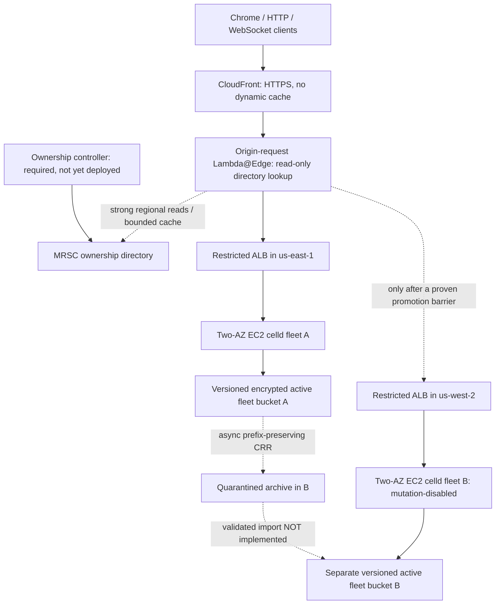

# Architecture and feasibility assessment

Status: **implementation and AWS validation in progress**, not a production
availability guarantee. The Lambda Web Adapter baseline remains independent.

## Decisions and boundaries

- **EC2 first, not EKS:** two arm64 nodes in separate AZs isolate celld's runtime,
  peer disk replication and restart behavior without a cluster control plane.
  50 GiB encrypted gp3 root volumes hold disposable caches and follower logs.
  Losing a volume is different from losing the authoritative S3 history.
- **Fixed routing:** SHA-256 of `v1\0` plus the exact namespace-bearing path,
  modulo 64. Health never changes shard placement. Changes require migration.
  No per-object override or public region override is implemented.
- **A-primary/B-standby:** the worker interlock keeps B mutation-disabled. This is
  NOT an MRSC lease implementation. No automatic writable promotion exists.
- **MRSC only:** strongly consistent reads use explicitly configured regional
  endpoints; there is no edge-local global endpoint. Cache hints expire within
  250 ms in the current deployment configuration and never outlive item expiry.
  Invalid/missing authoritative items do not cause endpoint-shopping; transport
  failures may try the second endpoint. Errors never invent a new owner.
- **Region constraint:** `us-west-1` is not currently MRSC-supported. Selecting a
  directory replica in `us-west-2` while keeping the fleet in `us-west-1` changes
  directory RTT, not application home regions. The user subsequently selected west2/east1/east2, so both fleets and replicas
  now target east1/west2, with east2 as witness. MREC is not an alternative
  arbitration mechanism.
- **Transport:** viewer HTTPS; initial CF→ALB→worker legs are HTTP. CloudFront
  prefix-list and secret-header guards are access controls, not encryption.
  Private-IP peer/operator listeners admit only fleet security-group traffic.
  No public node ingress/SSH. Production needs a TLS origin and a separately
  evaluated private-peer threat model.

## Actual local compatibility evidence

| Functionality | Evidence | Limit of claim |
|---|---|---|
| Start SSR / GET server function | Built Worker executes on pinned celld and serves HTML | Not just Vite dev; Eastern backend SSM probes also pass |
| Hydration / POST server function | Chrome button produces server result | Browser page actually loaded assets |
| Assets | Every SSR preload JS responds with JS content type | CDN cache/compression not benchmarked |
| Cookies / redirect | HTTP tests plus Chrome cookie readback and fixed redirect | Secure cookie on AWS still needs validation |
| Incremental stream | First chunk read before second chunk completes | Tiny local stream; backpressure/cancellation untested |
| Runtime APIs / bindings | URL, crypto UUID, TextEncoder, Assets/DO/Workflow | Not an exhaustive Workers API qualification |
| SQLite / operation IDs | Transactional commands, conflicts, concurrent duplicates | Deduplication history can be lost in regional replication gap |
| WebSocket updates | Authenticated snapshots and browser updates | Sockets reconnect; they do not migrate |
| Workflow | Native WorkflowEntrypoint steps, sleep, event, approval/rejection | Eastern cross-node workflow also passes; step effects can repeat before commit |
| Process restart | State, deduplication and committed workflow step survive | Local one-node object store, not AWS AZ/region loss |
| Process pause | Native owner self-fences after lease expiry; pending command not committed/acknowledged | Does NOT establish MRSC regional fencing |

## Fencing feasibility gate: not passed

Pinned celld `v0.6.2` source uses bucket conditional ownership and activation
prefixes for **node-level** fencing. It does not read the MRSC regional directory.
Two fleets with separate buckets therefore have independent native ownership.
An MRSC read, epoch header, or ingress gate cannot revoke already-running
SQLite work, sockets, alarms, queues or workflow replay.

Required integration before automatic writable promotion:

1. Carry canonical shard and regional authorization into native cell execution,
   including non-HTTP activation and internal cross-object/workflow calls.
2. Couple lease expiry and epoch loss to the native output gate, storage lineage
   and execution cancellation. Bound monotonic-clock uncertainty and shutdown
   headroom; a paused process must not resume commits before checking authority.
3. Prove an old-region barrier for outstanding work before enabling replacement
   writes. Never equate a controller flag or an ALB health failure with that barrier.
4. Use a durable, conditional single-item promotion state machine and recover
   its crash boundaries. No MRSC transactions or TTL deletion.
5. Validate a complete recovery point, import it with destination-local epoch
   bootstrap, then publish an ACTIVE route. Publication is not atomic with S3.

Until these are implemented and tested, routing metadata and `REGION_MODE` are
explicitly insufficient as a distributed storage fence. Mutations during quorum
loss and background authorization are still an outstanding requirement. A manual
recovery drill must prove physical old-fleet isolation and valid import; it must
not enable B merely because A is unhealthy.

## Recovery inventory and quarantine

All paths below are relative to a fleet bucket prefix at the pinned version.

| Artifact | Why it matters |
|---|---|
| `cells/<cell>/ltx/e<epoch>/<level>/<range>.ltx` | Complete snapshot/log lineage; a paged epoch may rely on earlier snapshots |
| `cells/<stream>/ltx/retired.json` | Retirement/GC provenance |
| `log/<session>/bundle/e<epoch>-<sequence>.ltxb` | L0 segments not yet drained into per-cell paths |
| `log/*.loss.json` | Explicit loss evidence |
| `nodes/<node>.json` | Lease authority AND folded recovery-log state: archive, do not run |
| Follower disk `peerlog/<node>/<generation>/` | May contain acknowledged writes not uploaded to S3 |
| `wake/entries/...`, `wake/retired/...`, `wake/format.json` | Workflow/alarm discovery and retirement compatible with SQLite state |
| `deploy/<script>/<version>/...`, `deploy-blobs/assets/...` | Manifest-referenced application/module/asset objects |
| `deploy/current.json`, script current pointers | Activation pointers; archive but do not publish before verifying artifacts |

`cells/<cell>/own.json`, node leases, `wake/waker.json` and `fleet/*` are source
coordination evidence, not transferable destination authority. The archive bucket
is inaccessible to serving nodes. Source changes arriving late cannot overwrite
B's active history because CRR never writes into B's active bucket.

**Import blocker:** merely dropping `own.json` and copying LTX is not supported
hydration. A missing native owner starts at epoch 1, while restoration expects
stored history to precede the new writer epoch. A validated epoch-bootstrap/import
mechanism is required; none was found in the pinned public CLI. Dry-run cell GC can
inspect restore chains but does not establish all checksums, missing acknowledged
tails, cross-cell consistency or actual SQLite hydration.

CRR is asynchronous and not an atomic checkpoint. Metrics and backlog alarms do
not establish a maximum delay or prove loss. Current CRR tooling does not backfill
objects created before the rule. RPO measurements must include both follower-disk
upload delay and CRR delay. Missing sequence history is not recoverable merely
because a sequence gap was detected. The policy for missing acknowledged writes
is to surface possible loss and reconcile against a client/external ledger, not
claim exactly-once effects. This lab has no payment/email/business effects.

Symmetric homes and failback need explicit reverse replication, epoch/prefix
isolation and reseeding; one-way A→B CRR cannot establish symmetric recovery.

## Connection and retry behavior

- CloudFront caching is disabled for the initial experiment. No origin failover
  group replays requests. Stateful errors fail closed.
- ALB idle timeout is 120 seconds; target deregistration delay is 30 seconds.
  CloudFront origin response timeout is 30 seconds and keepalive timeout 5 seconds.
- Existing WebSockets do not move to another node/region. The browser reconnects
  with jittered exponential backoff, a bounded five-failure budget, reauthentication
  and full snapshot resynchronization. Snapshot gaps/regressions are surfaced.
- No mutation is automatically retried. An ambiguous failure keeps the operation ID
  for inspection and explicit retry; creating a new ID can duplicate an effect.
- Operation IDs persisted in local SQLite are only local-history deduplication.
  A lost replica tail may also lose the idempotency record.

## Comparison / present assessment

The baseline is stateless Start on Lambda Web Adapter, so it does not need persistent
peer disks or cell ownership, and idle compute differs substantially. This experiment
moves Start itself into a Workers-compatible stateful host. The reference Workflow
branch provides isolation and lifecycle/recovery test ideas, but its TanStack Workflow
store/runtime is not used. celld's Cloudflare-compatible workflows are native cells
and inherit celld's persistence/fencing boundaries.

**Present assessment: NO-GO for automatic writable regional failover.** Local hosting
is demonstrated; both two-AZ fleets, MRSC and global ingress are deployed. Eastern
cross-node stateful probes pass. An earlier resident-owner loss run confirmed
eventual two-AZ replacement and native epoch advance, but did not prove that
survivor requests began after the old VM terminated. Protocol 2 now passes on
AWS with that explicit barrier, post-termination counter/Workflow probes,
native owner/epoch advance and healthy two-AZ replacement. This is graceful
single-region node termination, not abrupt power loss or regional fencing. Public HTTPS
compatibility and missing/FENCING directory refusal pass; no ACTIVE route or regional
promotion has been enabled. Chrome confirms public compatibility/fail-closed
behavior and local signed-ticket socket/Workflow completion. A graceful outage of
both eastern services recovered the original two-AZ fleet and acknowledged lab
state without standby selection. It does not establish region-outage recovery or
storage fencing. A final hosting
assessment, costs, cached/uncached routing percentiles, RPO/RTO, regional failover
and failback require the remaining issue checklist and deployed evidence.

The plan-first metadata operator binds the selected profile/account and each
replica's immutable table identity to ignored deployment evidence. Only absent→
FENCING and exact-row ACTIVE→FENCING are executable, including expired revocation.
It saves intent before submission and reconciles ambiguous outcomes by strong read,
never by write replay. Unique attempt artifacts preserve UNKNOWN outcomes. The
operator cannot activate, promote, switch regions, transact or run renewal loops.

Read-only recovery inventories compare source/archive versions as a non-atomic
ETag/size heuristic. Missing candidates demonstrate a completeness gap, not which
acknowledged celld writes were lost. An inert CRR probe establishes byte transfer
for one new S3 object, not peerlog coverage or an atomic recovery point. Small warm
sequential SSR benchmarks record client latency; different baseline/lab payloads
mean they are not an apples-to-apples performance or production-sizing comparison.

## Primary evidence references

- [celld ownership/output guarantees](https://github.com/denoland/celld/blob/v0.6.2/docs/guarantees.md)
- [Native output gate](https://github.com/denoland/celld/blob/v0.6.2/crates/logic/output_gate.rs)
- [LTX restoration and epoch constraints](https://github.com/denoland/celld/blob/v0.6.2/crates/celld/ltx_repl.rs)
- [Folded node-log metadata and follower recovery](https://github.com/denoland/celld/blob/v0.6.2/crates/celld/node_log.rs)
- [Workflow replay and compatibility limits](https://github.com/denoland/celld/blob/v0.6.2/docs/services/workflows.md)
- [MRSC consistency/restrictions](https://docs.aws.amazon.com/amazondynamodb/latest/developerguide/V2globaltables_HowItWorks.html)
- [AWS MRSC regional expansion](https://aws.amazon.com/about-aws/whats-new/2026/09/dynamodb-mrsc-additional-regions/)
