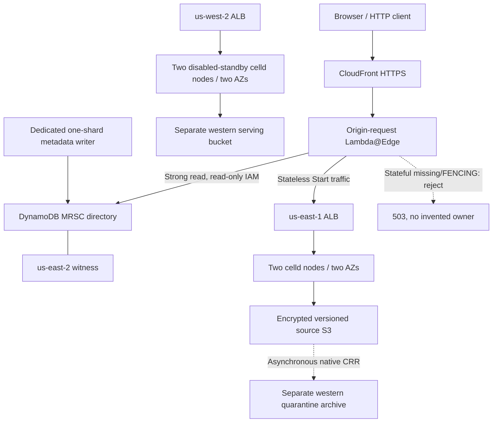

# TanStack Start and native celld Workflows on AWS: experiment report

## Executive summary

**Result: demonstrated fullstack hosting and bounded native-state recovery;
no-go for automatic writable regional disaster recovery.**

This experiment implements issue [#2](https://github.com/ataylorme/tanstack-start-aws-high-availability/issues/2)
in an independently deployable directory. TanStack Start itself executes in the
celld Worker runtime. Stateful examples use celld's native Cloudflare-compatible
Durable Objects, SQLite, WebSockets and `WorkflowEntrypoint`; no TanStack Workflow
package or actor-only sidecar substitutes for that hosting objective.

The isolated AWS deployment served Start through CloudFront and passed the
bounded runtime, multi-node, terminated-owner, archive and fail-closed checks
described below. Local Chrome and deployed Chrome checks exercised the browser
application. The final local suite contains **421 passing tests in 34 files**;
builds, typechecks, baseline smoke tests, CloudFormation lint and the repository
privacy scan also passed before publication.

The requested regional ownership/recovery design cannot be completed using the
inspected stock runtime's supported extension surfaces. An MRSC directory can
coordinate routing metadata, but does not fence native SQLite commits, internal
calls, existing sockets or background Workflow/alarm execution. A supported,
lineage-preserving destination recovery importer is also missing. The user
explicitly prohibited a celld fork. Accordingly, **no ACTIVE public stateful route,
automatic writable promotion or purported successful failback was enabled**.

The full objective was left blocked, not marked complete. Subsequent user
instructions authorize publication of these findings and teardown of the test.
See [resource disposition](#resource-disposition-and-publication) for cleanup
status and its verification boundary.

## Scope, constraints and reproducibility

- Pin: **celld v0.6.2**, upstream commit
  `90b43017241f81189453d326d05948f388b34652`.
- Official release archives are SHA-256 pinned in `celld.lock.json`. Installation
  verifies the compressed asset before unpacking. The abrupt-crash drill also
  compares the executing binary with that verified archive.
- Regional topology follows the user's override: eastern primary in **us-east-1**,
  disabled standby fleet in **us-west-2**, MRSC witness in **us-east-2**.
- Plain CloudFormation; independent experiment resources rather than changes to
  the baseline's deployed resources. EC2 was chosen over EKS for the initial
  bounded fleet experiment; see [architecture](ARCHITECTURE.md).
- Only supported native extensions are acceptable. No fork, custom serving
  runtime, fabricated ownership record or source-node identity reuse is used.
- Commands take an explicit AWS profile. Account identities, issued hosts, ARNs,
  resource IDs, tokens, raw measurements and deployment manifests remain in
  ignored local storage, not in this report or the public commit.
- Raw private evidence is preserved locally. Public results below are sanitized
  summaries, not a downloadable deployment-state or secret archive.

For deployment/local commands, use [README](README.md). For detailed native
requirements and source anchors, use [NATIVE-GAPS](NATIVE-GAPS.md). This report
summarizes evidence; it does not replace their safety gates.

## Architecture actually evaluated



The archive is deliberately distinct from the standby's serving bucket. Copied
source ownership/waker/node metadata is forensic evidence, not permission to
start a replacement writer. One-way CRR does not establish symmetric recovery.

The deployed fleet used four `t4g.medium` nodes total, encrypted gp3 root disks,
private peer/operator endpoints, isolated network rules, ALBs, logs and alarms.
Origin HTTP transport remains a limitation; public viewer HTTPS alone does not
prove end-to-end origin encryption. No production availability claim follows
from a healthy CloudFront endpoint or two-AZ placement.

## Runtime compatibility results

| Surface | Observed result | Boundary |
|---|---|---|
| Start SSR/static assets | Local and deployed probes passed | Not exhaustive Workers compatibility or production load qualification |
| Hydration/server functions | Chrome interaction and GET/POST probes passed | Browser checks are bounded examples, not a full UI regression matrix |
| Cookies/redirects | Set/read behavior and redirects passed | Not a comprehensive browser/cross-site security audit |
| Streaming/APIs/bindings | Incremental response and selected runtime/binding checks passed | Cancellation/backpressure and every API are not qualified |
| SQLite Durable Object | Transactional command sequence, value and operation-ID records passed | Local deduplication cannot restore records lost in a regional replication gap |
| WebSockets | Signed ticket, token authentication, snapshots and refusal checks passed | Existing sockets do not migrate; regional recovery is not proved |
| Native Workflows | Steps, sleep, approval/rejection, retries and bounded restart persistence passed | Not a complete retry/event/timeout/external-effect matrix |

The Counter writes operation ID, delta, sequence and resulting value in the same
SQLite transaction. Reusing a matching operation ID returns its original result;
a conflicting delta is rejected. Authenticated sockets publish snapshots.

Socket setup uses a short-lived signed ticket in the WebSocket subprotocol and
then token authentication. The UI holds credentials in memory rather than making
them durable browser state. Authentication/reconnect/catch-up is explicit;
snapshot recovery does not manufacture missing history.

## Failure and recovery evidence

### Native Workflow callback retry

An opt-in laboratory mode deliberately fails the first `started` callback **after**
its Counter effect is acknowledged. celld retries through the native step API.
Attempt 2 uses the same operation ID, receives the duplicate/original result, and
completes after approval with exactly the expected Counter commands.

This passed locally and through two eastern backend nodes. Two-node access does
not imply two independent Workflow executions. Early approval submission does not
prove its ordering relative to `waitForEvent`. Deduplicated laboratory effects do
not prove exactly-once external payments, messages or other business side effects.

### Graceful restart and unfinished-Workflow abrupt crash

The graceful restart test retains SQLite state, operation-ID deduplication and a
waiting Workflow, then completes the original Workflow without repeating its
committed first step.

A separate abrupt-crash drill copies the built app into a new ignored project
with fresh credentials and its own port/store. It observes an unfinished native
Workflow and its acknowledged first effect, authenticates an open socket, then
revalidates the exact directly owned native child before SIGKILL. It requires
both supervisor termination and native PID absence **before** restarting.

Same-disk restart retains unfinished state and deduplication. Fresh ticket/token
socket authentication returns the retained snapshot; approval completes the
original Workflow with exactly two Counter effects, and a later connection sees
the final snapshot. All owned drill processes are stopped afterward.

`waiting` can mean sleep or event wait: this does not establish an exact journal
phase or a crash during retry. It is same-disk local recovery, not remote disk
loss, automatic browser reconnect, generic import or regional failover.

### EC2 resident-owner termination

The corrected node-loss protocol identifies the actual resident native owner and
its live node lease before issuing one termination request. It waits for the
**exact EC2 instance to be `terminated`**, then starts survivor probes. The
survivor retains the expected Counter commands and Workflow history; native
ownership advances to a different node, and the ASG restores healthy two-AZ
capacity.

Earlier tests that began survivor probes after merely submitting asynchronous
termination were explicitly corrected: they could have forwarded to a draining
old owner. Those earlier runs are not post-death mutation proof. The corrected
terminal-state barrier is the evidence used here.

This proves the bounded in-region node-loss case, not full regional loss,
asymmetric partition or isolation of a still-running former regional primary.

### Native lease pause and graceful fleet outage

The local pause drill observes native self-fencing after the node lease expires
while a delayed mutation is outstanding. The resumed process does not acknowledge
that mutation, and the recovered history excludes it. This is the native
single-bucket node-lease boundary, **not** MRSC regional fencing.

A graceful two-service outage/restart exercise recovered the eastern fleet and
history. Graceful service stoppage is not an actual region outage or partition.

## Archive, restore and acknowledged-write observations

### Byte-verified archive and native offline validation

The post-drill quarantine archive contains a frozen manifest over 79 version-pinned
objects. The positive native verifier checked 19 full LTX payloads, rejected 19
intentional corruptions and checked 12 reconstructed SQLite images. The exact
three-command current laboratory acknowledgement ledger was recovered.

The verifier uses the pinned upstream LTX/epoch-chain libraries and dependency
lock in an **offline helper**, not a replacement serving runtime. Decoder checks
include decompression, page/index/trailer structure and checksums. SQLite integrity
is necessary but insufficient: exact operation-ID/sequence/value comparisons
provide the independent acknowledgement oracle.

Native bundled recovery logs matter: checking only per-cell LTX paths missed
acknowledged history present in bundles. Complete retirement provenance, folded
node-log authority and every unsent follower-disk tail remain unproved.

The actual archived Counter has a newer-epoch self-contained snapshot. That is
not deployed multi-span continuation. Six separate synthetic epoch-chain fixtures
cover continuation, incomplete intermediate epochs, clipped tails and missing
history. A missing newest tail can still form a valid older database; only an
external acknowledgement oracle detects that loss. Native TXID is not application
command sequence.

A `cell gc --dry-run` exit of zero is not used as restore proof: the pinned CLI can
suppress restore-plan errors. Timeouts, signals, crashes, missing executables and
unrelated CLI failures are never counted as successful corruption rejection.

### Completed Workflow journal

A digest-bound reconstructed Workflow database agreed with the completed
laboratory approval flow: four steps, consumed approval, expected Counter outputs,
retention alarm and an archived native wake publication with matching body/identity.
Only the tested V8 wire-format laboratory values are decoded. This does not
implement generic value migration, pending-work replay, latest-wake liveness,
destination activation or a globally atomic checkpoint.

### One acknowledged command through upload and native CRR

One independent probe submits exactly one unique Counter mutation, then observes
that exact command through source native LTX/bundle decoding and independent
restoration from its CRR replica. Source and destination have the same captured
keys, version IDs, lengths and hashes; source versions report `COMPLETED` and
replicas report `REPLICA`. No manual copy/backfill or serving import is involved.

Conservative controller-observed upper presence bounds were approximately
**6.7 seconds at source S3** and **24.2 seconds at the quarantine replica**, with
lower bounds of zero. They include SSM, polling, transfer, hashing, decoding and
SQL overhead. They are **not exact upload/CRR latency, universal RPO, an SLA or a
complete acknowledged-tail exposure bound**. Earlier instrumentation failures
remain failed runs, even where later offline diagnostics found their marker.

## Routing, directory and IAM

- Canonical object identity maps to a fixed versioned shard set, not a freshly
  recomputed healthy-region owner. Invalid IDs/regions are rejected.
- Origin-request Lambda@Edge performs dynamic origin selection. Directory reads
  use explicit regional endpoints and strong consistency, with bounded cache,
  timeouts and endpoint failover. Cached ownership is only a hint.
- Missing, invalid, expired or unavailable authority does not invent an owner.
  Public missing/FENCING GET and POST routes reject despite spoofed routing hints.
  Mutations are not replayed by failover logic.
- The deployed MRSC table has two replicas and the witness. Fleet roles have no
  directory write permission; the edge reader is read-only.
- A dedicated operator role permits Get/Put/Update for one exact shard on two exact
  table ARNs. Missing leading-key and enclosing transaction contexts cannot match
  its Allow. No Scan/Delete/Batch/PartiQL/IAM-management grant is included.
- Mutation tooling verifies recorded account/stack/table identities and live exact
  role trust/policy inventory before assuming a temporary role. Incomplete IAM
  inventories and policy drift fail closed. No credential is persisted and there
  is no fallback to the broad source profile.
- A bounded inert FENCING initialization passed through that role and was strongly
  read from the other replica. No ACTIVE item was created.

IAM cannot constrain arbitrary status values or require the CLI's CAS expression.
A raw holder of this role can write its permitted item differently. Its policy
preflight is point-in-time, not an atomic defence against administrators, role
replacement or table resource-policy grants. MRSC protects directory metadata,
not asynchronously replicated celld state.

## Why writable regional failover is a no-go

Fresh upstream checks found the [latest release](https://github.com/denoland/celld/releases/tag/v0.6.2)
and [default-branch commit](https://github.com/denoland/celld/commit/90b43017241f81189453d326d05948f388b34652)
unchanged from the pin.

1. **No supported native regional authorization hook.** JavaScript admission,
   epoch headers, egress `globalOutbound` and post-response tails do not universally
   fence transaction/output, internal calls, socket messages, alarms or Workflows.
   Hidden, test-only store injection and public Rust traits are not supported
   plugin registration in the shipped binary.
2. **No supported generic epoch/lineage importer.** Removing source ownership can
   start an independent native epoch at one. Copying historical bytes or source
   identities does not establish a validated destination-owned bootstrap floor.
3. **No safe activation barrier.** Without both facilities, metadata transitions
   cannot prove the old region has stopped committing and the replacement has the
   complete recoverable state before becoming writable.

Consequently, controller promotion/restart, concurrent ownership attempts,
in-flight/background fencing under partition, old-primary rejoin and failback,
and full regional RPO/RTO remain unverified. No application-only substitute or
fork was introduced to make those tests appear green.

To reopen this path, upstream must expose suitable supported authorization and
recovery/bootstrap facilities. Their existence alone is not enough: integrate
and adversarially validate them against every outstanding criterion before
publishing a writable route. See [the detailed gates](NATIVE-GAPS.md).

## Observability, latency and cost

The live read-only observability verifier validated log freshness on four nodes,
CPU/health series and eight alarm configurations. Missing/stale data is not zero
or healthy. An archive-backlog alarm was active and reported explicitly as a
warning, not concealed as overall DR health. No notification target was configured;
notification delivery and deliberate alarm transitions were not tested.

### Directory benchmark

Each scenario used five warmups and 50 sequential samples from the development
client, not an edge location. Rounded milliseconds:

| Scenario | p50 | p95 | p99 |
|---|---:|---:|---:|
| Strong inert read, us-east-1 | 109.4 | 196.5 | 199.1 |
| Strong inert read, us-west-2 | 95.5 | 172.0 | 247.9 |
| Injected first-endpoint refusal + real second read + FENCING refusal | 95.4 | 143.0 | 148.3 |

The refusal is injected locally, not an AWS endpoint/quorum outage. Separate
ACTIVE cached/uncached timings are synthetic in-memory overhead with no network
or authority grant; they do not demonstrate a deployed ACTIVE cache path.
Preliminary SSR measurements use different baseline/lab workloads, so they do
not establish a runtime performance winner or production capacity.

### Partial operating-cost model

Read-only resource/price probes inventory running nodes, attached encrypted gp3,
ALBs, primary-node public addresses and actual associated ALB public IPv4
allocations. The ALB inventory matches exact stack-owned ENIs to service-managed
Elastic IPv4 allocation identities; it does not infer a two-AZ minimum.

The observed partial list-price floor was **$0.2194/hour plus $16/month gp3**;
a clearly hypothetical 730-hour steady-state illustration is approximately
**$176.16**. This is not an actual account bill or a complete cost estimate.

A separate catalog retrieved 22 regional price schedules and exercised explicitly
synthetic billing-unit scenarios. Counts of current simple alarms were checked,
but full-month prices do not establish actual lifetime billing. Rates, units,
contiguous tiers, effective dates and missing categories are validated; free-tier
allocation, credits and discounts are not invented.

Unpriced/incomplete categories include workload traffic and LCUs, exact resource
lifetimes and historical address-hours, CPU surplus, extra provisioned disk
performance, directory operations/retained storage, S3 requests/version storage,
CRR/transfer, CloudFront/Lambda@Edge, logs/custom metrics and retained artifacts.
Current dedicated DynamoDB billing guidance treats the witness and global-table
replication transfer differently from S3 CRR; those costs must not be conflated.
See [COSTS](COSTS.md) for units, primary sources and exclusions.

## Acceptance audit

| Issue criterion | Conclusion |
|---|---|
| Start served through CloudFront from celld | Demonstrated for the isolated deployment |
| Native object persistence across restart/node loss | Demonstrated for bounded local and in-region node-loss cases |
| One ownership policy across HTTP/socket/internal/background execution | Blocked: no native regional authority integration |
| Canonical/shard/cache/endpoint/unavailable routing coverage | Protocol tests and fail-closed deployed checks; no ACTIVE native fence proof |
| MRSC/witness and least-privilege directory components | Deployed/verified; operator limitations and provisioning exception documented |
| Concurrent promotion/controller restart | Blocked |
| In-flight/paused/expired/socket/background regional fencing | Blocked; local native lease test is not regional proof |
| No unsafe coordination fallback | Fail-closed paths implemented; real native quorum-loss lifecycle incomplete |
| Full fault matrix | Partial: node loss/pause/graceful outage, not actual regional/asymmetric partition/failback |
| Backlog/incomplete chains/missing acknowledgements/duplicates/effects | Partial: archive/native fixtures/ledger/retry evidence, not all tails or business effects |
| Regional exclusivity or documented no-go | No-go documented; no automatic writable failover enabled |
| Failover/failback with measured loss/RPO/RTO/socket isolation | Blocked |
| Complete latency/recovery/cost benchmark | Partial; no full regional RPO/RTO or operating bill |
| Architecture/runbooks/limitations/cleanup/comparison | Included; cleanup disposition is tracked below |

For the longer criterion-by-criterion evidence mapping, see [ASSESSMENT](ASSESSMENT.md).
Unchecked compound requirements in README remain incomplete, not implicitly waived.

## Relationship to the other experiments

The root Lambda Web Adapter application remains independently buildable and its
healthy/simulated-failure smoke checks pass. Its stateless HTTP failover does not
establish stateful actor recovery. Shared CI now also validates the independent
celld experiment and its CloudFormation templates.

The [TanStack Workflow reference branch](https://github.com/ataylorme/tanstack-start-aws-high-availability/tree/test/tanstack-workflow-aws)
informed experiment structure and validation, not the implementation engine.
Package-specific MRSC workflow ownership/wakeup evidence cannot be transferred to
celld's native execution/storage semantics. No performance, safety or cost
superiority is claimed across unlike workloads and historical engines.

## Implementation map and verification commands

| Path | Purpose |
|---|---|
| `src`, `runtime`, `vite.config.ts`, `wrangler.jsonc` | Start build, native Counter/Workflow examples, interlocks and bindings |
| `infra` | Independent regional/global/directory/deployer/writer CloudFormation |
| `routing`, `ownership` | Canonical routing, directory reads and conditional inert metadata operations |
| `recovery` | Archive/native LTX/epoch/Workflow journal validation |
| `measurements` | Latency, current inventory, pricing and replication-observation rules |
| `operations` | Identity-bound cleanup/fault and socket-observation safety helpers |
| `scripts` | Plan/deploy/verify/drill/benchmark/privacy/cleanup entrypoints |
| `../../tests/celld-*.test.ts` | Runtime-tooling, protocol, safety and infrastructure regressions |

From the repository root:

```sh
npm run check
npm run smoke
cfn-lint -t infra/*.yaml experiments/celld/infra/*.yaml
git diff --check
```

`check` builds baseline and edge, typechecks, runs tests, builds/typechecks celld
and scans prospective public files for private deployment information. Native
runtime/drill evidence requires the separate documented commands and cannot be
inferred from this unit suite. No new framework dependencies were added.

## Resource disposition and publication

### Ordered publication and authorized teardown

The user authorized publication first and teardown afterward. The initial report
and implementation were committed and pushed as `9401fe4` on `feat/celld-test`;
the remote commit hash was verified before any destructive AWS operation.
GitHub Actions validation for that commit passed, including the baseline container
build/smoke checks. Private deployment evidence and credentials were not staged.

**Active experiment infrastructure has now been removed.** A final identity-bound
read-only audit passed 32 checks against the recorded resources and their terminal
API states. This is infrastructure teardown, not the missing regional failover
experiment and not a claim that all AWS-retained historical data is erased.

| Resource group | Verified outcome |
|---|---|
| Six experiment CloudFormation stacks | All `DELETE_COMPLETE`; current stack resources are deleted or explicitly retained for separate cleanup |
| CloudFront distribution and custom origin-request policy | Exact resources absent |
| Eastern and western fleets | ASGs absent; no nonterminated instances for the owned groups |
| Regional networks | VPCs and their ENIs absent; stack-managed ALB/network resources deleted |
| Captured fleet disks and ALB Elastic IPv4 allocations | Exact volume/allocation identities absent |
| Four retained versioned S3 buckets | Versions and delete markers purged, multipart uploads checked/aborted, buckets deleted and authorized HeadBucket checks return 404 |
| DynamoDB directory | Both former replica tables absent; witness removed through the paired replica/witness transition before deleting the final table |
| Lambda@Edge | AWS released the replicas; original function/all versions absent, retained execution role absent, observed exact-function log groups removed across enabled regions |
| Retained node logs and experiment roles | Exact retained log groups and recorded roles absent |
| On-demand backups / AWS Backup | The exact-table inventory returned only the two SYSTEM snapshots described below; no matching AWS Backup protected-resource entries were returned |

The standard cleanup command deliberately retains storage, the directory and edge
artifacts, so its successful stack deletion was **not** treated as full teardown.
Those resources were removed separately using captured physical identities and
fresh API checks, never a broad account-wide prefix deletion. Historical retained
edge versions were included by removing the original function after AWS released
replication. Shared service-linked roles and unrelated baseline resources were
not targeted.

The fleets were scaled to zero during CloudFront deletion to stop writers. All
remaining owned bucket replication configurations were removed. The S3 purge
included noncurrent versions: ordinary recursive object removal would not have
emptied these buckets. Closed-response delete batches remained unknown, their
requests were preserved privately, and fresh listings selected the still-present
immutable versions for subsequent idempotent deletion. Only final bucket absence
was used as completion evidence.

Deletion protection was disabled only on the verified directory replicas. The
other replica and witness were removed together through the supported update,
then the surviving table was deleted. Lambda@Edge deletion initially refused
because AWS still held replicated versions; cleanup waited for service release
rather than attempting unsupported manual replica deletion.

### AWS-enforced residual data retention

Deleting the PITR-enabled directory tables created **two AWS-managed SYSTEM
backups**, one in each former replica region. Both were matched to their captured
immutable table IDs. Explicit deletion attempts returned AWS's refusal that users
cannot delete these SYSTEM backups. The recorded expiration is **November 20,
2026 (UTC)**. Their identifiers and exact metadata remain private.

AWS documents that a deleted-table PITR snapshot is retained for up to 35 days
**at no additional cost**. These are not running table replicas, a witness,
user-created on-demand backups or an active experiment fleet. They are a residual
copy of test data until AWS's expiry—not proof of complete data erasure.
[Deleted-table PITR behavior](https://docs.aws.amazon.com/amazondynamodb/latest/developerguide/PointInTimeRecovery_Howitworks.html),
[DynamoDB pricing](https://aws.amazon.com/dynamodb/pricing/).

The final public report contains no resource IDs, endpoints, account identity or
raw deletion evidence. Local ignored logs, archives, credentials and development
fixtures were not published or deleted as part of AWS teardown. Billing can lag
resource removal: this audit is not a reconciled final invoice, a claim that
historical charges disappeared, or a guarantee of zero charges elsewhere in the
account.
